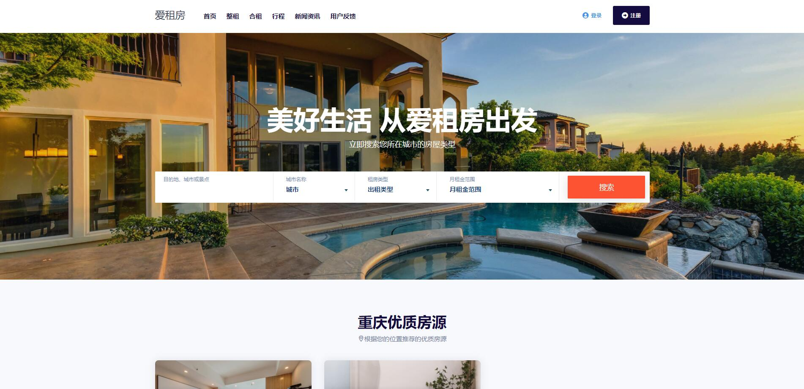
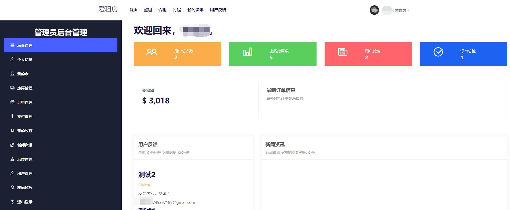
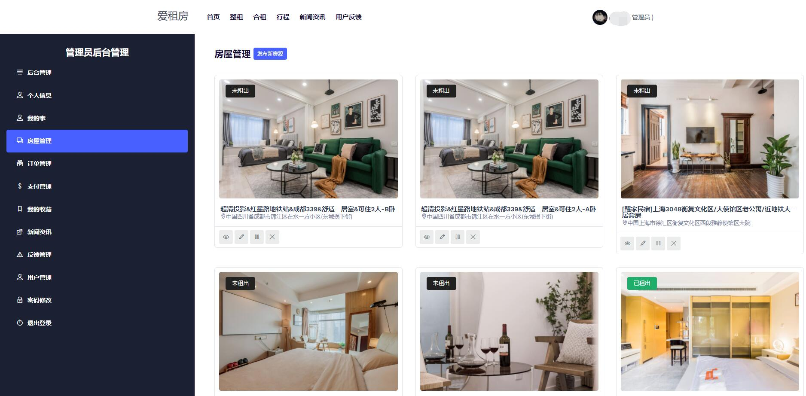

### 简介 :wave:
- 本项目是基于Springboot开发的一款房屋租赁系统。
- 使用Springboot + JSP + MySQL + MybatisPlus + HTML/CSS/JS/bootstrap 进行开发。
- TIP:本项目已作为本人的 **2022年毕业设计项目 ，请勿用作自己的毕业设计！**
- 目前此项目已经趋于完结，剩下的内容就是修复BUG和更新一些小功能。

### 功能开发进度

 **前端页面功能** 

- 房屋整租、合租功能
- 房屋搜索功能
- 新闻咨询版块
- 用户反馈版块
- 定位推荐房屋功能
- 旅游胜地推荐功能

 **后台管理面板** 

- 个人信息管理
- 房屋管理
- 订单管理
- 支付管理
- 收藏功能
- 新闻管理
- 反馈管理
- 密码修改

### 基础环境 :speech_balloon:
- IntelliJ IDEA
- JDK 1.8
- Mybatis 3.1
- Mysql 5.8

### 功能介绍

1. 用户：租客、房东、管理员
1. 新闻：发布新闻内容、旅游攻略等栏目
1. 推荐：推荐优秀房屋数据来展示到前端页面
1. 反馈：反馈功能可以在前后端进行展示，接收用户反馈信息
1. 支付：支付功能支付宝、微信、PAYPAL、银行卡、礼品卡支付（目前功能在做，已完成模拟支付的方式）

### 特征 :alien:

1. 多用户开发（租客、房东、管理员）
1. 注册用户可自由选择租客、房东身份进行访问。
1. 开发环境：JSP + SpringBoot + MybatisPlus + MySql + JDK1.8

### 安装教程

1. 下载项目文件、解压
1. 打开开发工具进行导入（推荐IDEA）
1. 修改数据库配置、邮件发送等配置
1. 打包成Jar包或War包
1. 上传至服务器后运行Jar包即可

 **如果是本地测试，仅需要完成第1、2、3步即可。** 

### 预览截图

### 测试实例
Demo: 暂时下架。

| 管理员   |        |
|-------|--------|
| 用户名   | 密码     |
| admin | 123456 |
| 普通用户  | 租客     |
| test1 | 123123 |

**注意：**

1. 请勿修改账号和密码，以便于其他用户进行测试。
1. 请勿对实例服务器进行不友好行为，谢谢！